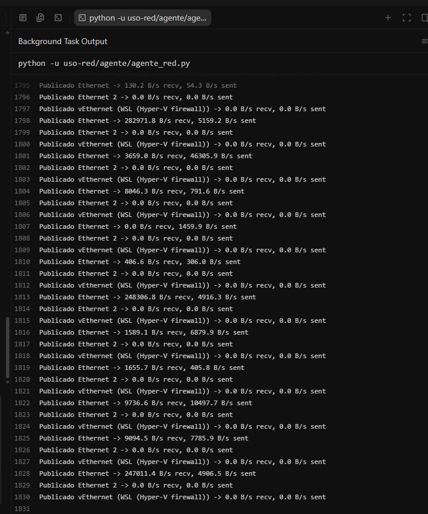
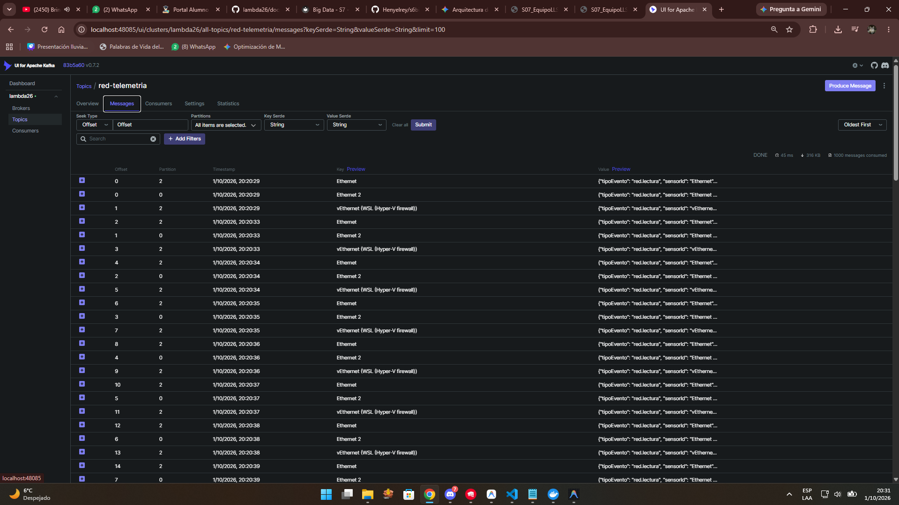
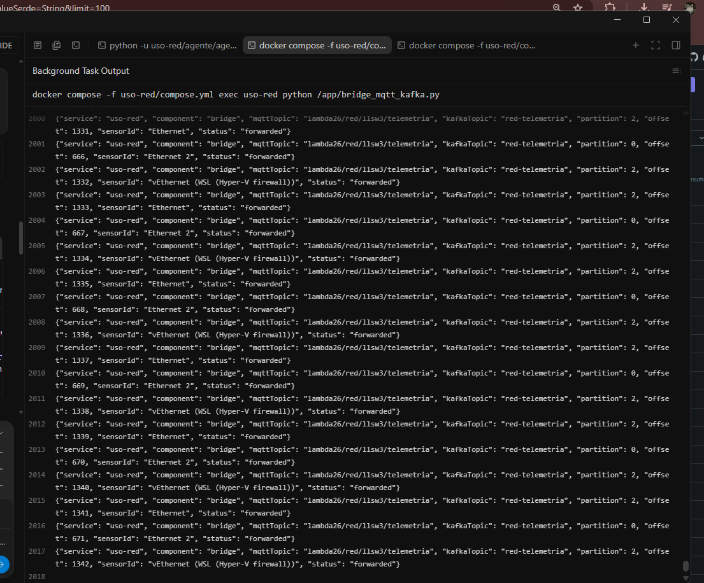
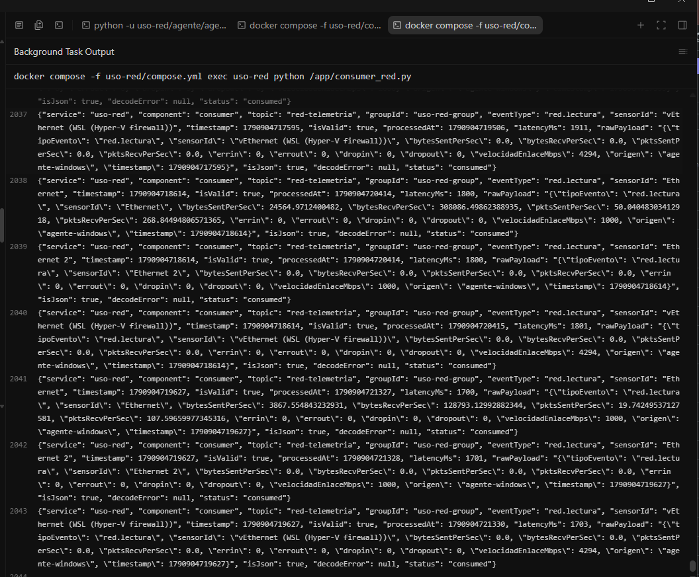
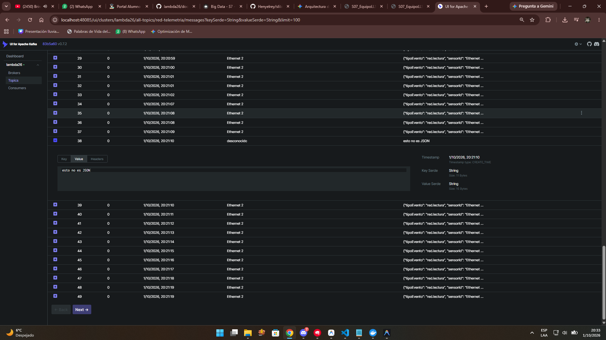
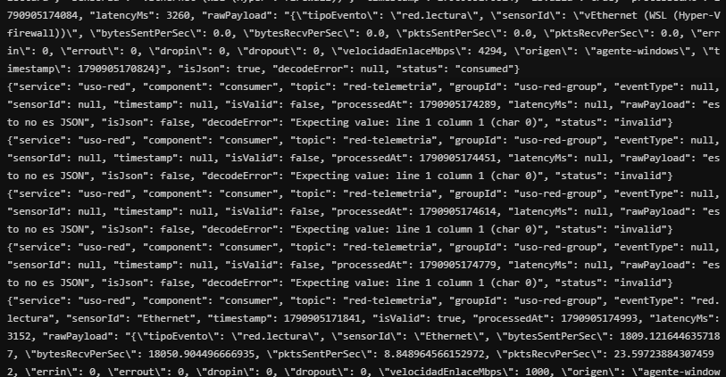

# S07 — Informe de Actividad Autónoma: Ingesta IoT con Sensor Real

## Datos del estudiante

- **Nombre:** *Henyelrey Lucio Garcia Chura*
- **Equipo:** 
- **Sesión:** S07 — Ingesta de Eventos IoT/Sensores en Tiempo Real
- **Rol o aporte realizado:** Diseño e implementación completa del módulo `uso-red`: agente de telemetría de red que lee contadores reales de las NICs físicas de la PC (bytes, paquetes, errores, descartes por segundo), los publica por MQTT hacia un Mosquitto propio en contenedor, un bridge los reenvía a Kafka, y un consumer los valida por esquema y por rango físico (capacidad del enlace y umbral de saturación).
- **Link de GitHub:** *https://github.com/Henyelrey/s7big-data.git*

---

## Evidencia técnica

### 1. Sensor físico real conectado y funcionando

El "sensor" de este Proyecto Sello es **la tarjeta de red física (NIC) de esta PC** — no un simulador ni un componente de Wokwi. El agente (`agente/agente_red.py`) corre nativamente en Windows (fuera de Docker, porque Docker Desktop no expone las NICs físicas del host) y usa `psutil` para leer los contadores reales del sistema operativo cada segundo.



Las interfaces detectadas y publicando datos reales son:

| Interfaz | Tipo | Velocidad reportada |
|---|---|---|
| `Ethernet` | NIC física (Realtek / Intel del equipo) | 1000 Mbps |
| `Ethernet 2` | NIC secundaria (sin tráfico activo) | 1000 Mbps |
| `vEthernet (WSL (Hyper-V firewall))` | NIC virtual de Hyper-V/WSL | 4294 Mbps (virtual) |

El agente filtra automáticamente las interfaces de loopback y Teredo (`Pseudo-Interface`), y solo publica las que están activas (`isup = True`).

**Log del agente** (lecturas reales cada 1 segundo):

```text
Conectando a broker MQTT en localhost:41883...
MQTT conectado: Success
Iniciando lecturas de red cada 1000 ms...
Publicado Ethernet -> 17448.1 B/s recv, 15393.5 B/s sent
Publicado Ethernet 2 -> 0.0 B/s recv, 0.0 B/s sent
Publicado vEthernet (WSL (Hyper-V firewall)) -> 0.0 B/s recv, 0.0 B/s sent
Publicado Ethernet -> 218.3 B/s recv, 196.7 B/s sent
Publicado Ethernet 2 -> 0.0 B/s recv, 0.0 B/s sent
Publicado vEthernet (WSL (Hyper-V firewall)) -> 88.5 B/s recv, 88.5 B/s sent
Publicado Ethernet -> 1752.9 B/s recv, 4659.9 B/s sent
Publicado Ethernet -> 586623.3 B/s recv, 182579.1 B/s sent
Publicado Ethernet -> 256506.5 B/s recv, 7117.2 B/s sent
Publicado Ethernet -> 150382.7 B/s recv, 7177.6 B/s sent
```

El agente lee los contadores acumulados del SO (`psutil.net_io_counters(pernic=True)`), calcula la diferencia entre la lectura actual y la anterior, y divide por el intervalo de tiempo real transcurrido para obtener tasas por segundo. Esto garantiza que los datos son **mediciones reales del tráfico de red del campus** que pasa por esta máquina, no valores inventados.

---

### 2. Kafka UI con el topic propio del Proyecto Sello y su distribución de particiones

**Topic:** `red-telemetria`
**Particiones:** 3
**Consumer group:** `uso-red-group`
**Kafka UI:** `http://localhost:48085`

```text
Topic: red-telemetria    PartitionCount: 3    ReplicationFactor: 1
    Partition: 0    Leader: 1    Replicas: 1    Isr: 1
    Partition: 1    Leader: 1    Replicas: 1    Isr: 1
    Partition: 2    Leader: 1    Replicas: 1    Isr: 1
```



**Distribución real de `sensorId` por partición** (observada en los logs del bridge):

| `sensorId` | Partición |
|---|---|
| `Ethernet` | 2 |
| `Ethernet 2` | 0 |
| `vEthernet (WSL (Hyper-V firewall))` | 2 |

La partición 1 queda sin uso con estos 3 `sensorId` — mismo comportamiento documentado en la sesión (2.1): el particionado por `key` garantiza **orden por dispositivo**, no un reparto parejo entre particiones.

**Log del bridge** (reenvío MQTT → Kafka con partición asignada):

```json
{"service": "uso-red", "component": "bridge", "mqttHost": "mosquitto", "mqttTopic": "lambda26/red/llsw3/telemetria", "status": "connected"}
{"service": "uso-red", "component": "bridge", "mqttTopic": "lambda26/red/llsw3/telemetria", "kafkaTopic": "red-telemetria", "partition": 2, "offset": 0, "sensorId": "Ethernet", "status": "forwarded"}
{"service": "uso-red", "component": "bridge", "mqttTopic": "lambda26/red/llsw3/telemetria", "kafkaTopic": "red-telemetria", "partition": 0, "offset": 0, "sensorId": "Ethernet 2", "status": "forwarded"}
{"service": "uso-red", "component": "bridge", "mqttTopic": "lambda26/red/llsw3/telemetria", "kafkaTopic": "red-telemetria", "partition": 2, "offset": 1, "sensorId": "vEthernet (WSL (Hyper-V firewall))", "status": "forwarded"}
```



---

### 3. Logs de productor/puente y consumer con lecturas reales de punta a punta

**Flujo completo verificado:**

```text
NIC física (Windows) → agente_red.py → MQTT (mosquitto:41883) → bridge_mqtt_kafka.py → Kafka (red-telemetria) → consumer_red.py
```



**Consumer recibiendo lecturas reales con `status: "consumed"`:**

```json
{
  "service": "uso-red",
  "component": "consumer",
  "topic": "red-telemetria",
  "groupId": "uso-red-group",
  "eventType": "red.lectura",
  "sensorId": "Ethernet",
  "timestamp": 1790904028505,
  "isValid": true,
  "processedAt": 1790904029314,
  "latencyMs": 809,
  "isJson": true,
  "decodeError": null,
  "status": "consumed"
}
```

```json
{
  "service": "uso-red",
  "component": "consumer",
  "topic": "red-telemetria",
  "groupId": "uso-red-group",
  "eventType": "red.lectura",
  "sensorId": "Ethernet 2",
  "timestamp": 1790904028505,
  "isValid": true,
  "processedAt": 1790904029352,
  "latencyMs": 847,
  "isJson": true,
  "decodeError": null,
  "status": "consumed"
}
```

```json
{
  "service": "uso-red",
  "component": "consumer",
  "topic": "red-telemetria",
  "groupId": "uso-red-group",
  "eventType": "red.lectura",
  "sensorId": "vEthernet (WSL (Hyper-V firewall))",
  "timestamp": 1790904028505,
  "isValid": true,
  "processedAt": 1790904029354,
  "latencyMs": 849,
  "isJson": true,
  "decodeError": null,
  "status": "consumed"
}
```

Las tres interfaces llegan de punta a punta con latencias reales de ~800 ms (agente → MQTT → bridge → Kafka → consumer).

---

### 4. Contrato de evento propio del Proyecto Sello

**Tabla 1. Contrato del evento `red.lectura`**

| Campo | Tipo | Descripción |
|---|---|---|
| `tipoEvento` | string | Siempre `"red.lectura"`. |
| `sensorId` | string | Nombre de la interfaz de red (ej. `"Ethernet"`) — también es la `key` de Kafka. |
| `bytesSentPerSec` | number | Bytes enviados por segundo (tasa calculada entre lecturas consecutivas). |
| `bytesRecvPerSec` | number | Bytes recibidos por segundo. |
| `pktsSentPerSec` | number | Paquetes enviados por segundo. |
| `pktsRecvPerSec` | number | Paquetes recibidos por segundo. |
| `errin` | number | Errores acumulados de entrada (contador del SO). |
| `errout` | number | Errores acumulados de salida. |
| `dropin` | number | Paquetes descartados en entrada (acumulado). |
| `dropout` | number | Paquetes descartados en salida (acumulado). |
| `velocidadEnlaceMbps` | number | Velocidad del enlace en Mbps, reportada por el SO (ej. `1000` para Gigabit Ethernet). |
| `origen` | string | Siempre `"agente-windows"`. |
| `timestamp` | number | Fecha/hora en milisegundos epoch (UTC). |

**Ejemplo de payload real:**

```json
{
  "tipoEvento": "red.lectura",
  "sensorId": "Ethernet",
  "bytesSentPerSec": 15393.52,
  "bytesRecvPerSec": 17448.05,
  "pktsSentPerSec": 41.95,
  "pktsRecvPerSec": 42.95,
  "errin": 0,
  "errout": 0,
  "dropin": 0,
  "dropout": 0,
  "velocidadEnlaceMbps": 1000,
  "origen": "agente-windows",
  "timestamp": 1790904028505
}
```

**Tabla 2. Configuración de `uso-red` (variables de entorno)**

| Variable | Por defecto | Aplica a |
|---|---|---|
| `MQTT_HOST` / `MQTT_PORT` | `localhost` / `41883` (agente), `mosquitto` / `1883` (bridge) | agente y bridge |
| `MQTT_TOPIC` | `lambda26/red/llsw3/telemetria` | agente y bridge |
| `AGENTE_INTERVAL_MS` | `1000` | agente |
| `AGENTE_INTERFACES` | *(vacío = todas las activas, salvo loopback/teredo)* | agente |
| `KAFKA_BOOTSTRAP_SERVERS` | `kafka:9092` | bridge y consumer |
| `KAFKA_TOPIC_RED` | `red-telemetria` | bridge y consumer |
| `KAFKA_GROUP_ID` | `uso-red-group` | consumer |
| `UMBRAL_SATURACION_PCT` | `70` | consumer |

**Key recomendada:** `sensorId`

**Topic:** `red-telemetria` (3 particiones)

**Validación de rango físico en el consumer:**

| Condición | `status` |
|---|---|
| Cualquier tasa (`bytesSentPerSec`, `bytesRecvPerSec`, etc.) negativa → contador reiniciado | `alerta` |
| `bytesSentPerSec` o `bytesRecvPerSec` > `velocidadEnlaceMbps` × 125 000 × 1.05 → supera capacidad física del enlace | `alerta` |
| `bytesSentPerSec` o `bytesRecvPerSec` > `velocidadEnlaceMbps` × 125 000 × (`UMBRAL_SATURACION_PCT` / 100) → saturación operativa | `saturacion` |
| Lectura válida y dentro de rango | `consumed` |
| No es JSON, falta un campo, o tipo incorrecto | `invalid` |

---

### 5. Evidencia de validación de rango físico provocada

#### 5.1 Evento `invalid` — falla de esquema

Se publicó un texto plano (no JSON) directamente en el topic MQTT:

```text
esto no es JSON
```

**Bridge:** lo reenvió tal cual (sin validar ni transformar):

```json
{"service": "uso-red", "component": "bridge", "mqttTopic": "lambda26/red/llsw3/telemetria", "kafkaTopic": "red-telemetria", "partition": 0, "offset": 38, "sensorId": "desconocido", "status": "forwarded"}
```

**Consumer:** lo marcó `invalid` sin caerse:

```json
{
  "service": "uso-red",
  "component": "consumer",
  "topic": "red-telemetria",
  "groupId": "uso-red-group",
  "eventType": null,
  "sensorId": null,
  "timestamp": null,
  "isValid": false,
  "processedAt": 1790904070195,
  "latencyMs": null,
  "rawPayload": "esto no es JSON",
  "isJson": false,
  "decodeError": "Expecting value: line 1 column 1 (char 0)",
  "status": "invalid"
}
```



#### 5.2 Evento `alerta` — falla de rango físico

Se publicó un evento JSON válido con todos los campos correctos, pero con `bytesSentPerSec` y `bytesRecvPerSec` de **999 999 999 B/s** — imposible en un enlace de 1000 Mbps (cuya capacidad máxima teórica es 125 000 000 B/s):

```json
{
  "tipoEvento": "red.lectura",
  "sensorId": "Ethernet",
  "bytesSentPerSec": 999999999.0,
  "bytesRecvPerSec": 999999999.0,
  "pktsSentPerSec": 50000.0,
  "pktsRecvPerSec": 50000.0,
  "errin": 0,
  "errout": 0,
  "dropin": 0,
  "dropout": 0,
  "velocidadEnlaceMbps": 1000,
  "origen": "agente-windows",
  "timestamp": 1790904074204
}
```

**Consumer:** esquema válido (`isValid: true`), pero marcado `alerta` porque 999 999 999 B/s > 1000 × 125 000 × 1.05 = 131 250 000 B/s:

```json
{
  "service": "uso-red",
  "component": "consumer",
  "topic": "red-telemetria",
  "groupId": "uso-red-group",
  "eventType": "red.lectura",
  "sensorId": "Ethernet",
  "timestamp": 1790904074204,
  "isValid": true,
  "processedAt": 1790904077390,
  "latencyMs": 3186,
  "isJson": true,
  "decodeError": null,
  "status": "alerta"
}
```



Esto demuestra que el consumer **no se cae** ante ninguno de los dos tipos de dato inválido del caso 1.6.1, y que distingue correctamente entre una falla de forma (`invalid`) y una falla de valor (`alerta`).

---

## Reflexión técnica breve

> **¿Qué tuviste que resolver para pasar de un sensor simulado en Wokwi a uno real que tu Proyecto Sello va a usar de verdad, y por qué el mismo patrón dispositivo → MQTT/Kafka → puente → validación siguió funcionando sin cambios de fondo?**

El principal desafío fue que la tarjeta de red no es un microcontrolador con firmware propio — es un recurso del sistema operativo que solo se puede leer desde Windows, no desde un contenedor Docker (Docker Desktop aísla completamente la red del host con su propia red virtual). Por eso el agente corre fuera de Docker como un script nativo de Python con `psutil`, publicando por MQTT hacia un Mosquitto propio en contenedor, en vez de hacia un broker público como `test.mosquitto.org`.

El segundo desafío fue definir qué significa "rango físico" para tráfico de red: no es un intervalo fijo como temperatura (-20 a 60 °C), sino un límite que **depende de cada interfaz** — la capacidad máxima del enlace (`velocidadEnlaceMbps × 125 000 B/s`). Además, el consumer necesitó un cuarto estado (`saturacion`) que no existía en `uso-atmos`: una lectura que es físicamente posible pero que indica que el enlace está operando por encima del umbral saludable (70 % por defecto).

Lo que **no** cambió fue el patrón de fondo: dispositivo → MQTT → puente → Kafka → consumer con validación. El bridge sigue reenviando el payload sin validar ni transformar. El consumer sigue siendo el único punto donde se valida esquema y rango. El `sensorId` sigue siendo la `key` de Kafka para garantizar orden por interfaz. Cambió la fuente de datos y el contrato del evento, pero la arquitectura es exactamente la misma de la sesión — esa es la ventaja de un diseño desacoplado por mensajería.

---

## Arquitectura del flujo

```text
NIC física (Ethernet) ─┐
NIC virtuales ─────────┤  agente/agente_red.py   (Windows, fuera de Docker)
                       ▼  MQTT  lambda26/red/llsw3/telemetria
               mosquitto (contenedor, puerto 41883 del host)
                       ▼
               app/bridge_mqtt_kafka.py  → Kafka: red-telemetria (3 particiones, key = sensorId)
                       ▼
               app/consumer_red.py       → consumed | invalid | alerta | saturacion
```

---

## Estructura de archivos

```text
uso-red/
├── README.md
├── Dockerfile
├── compose.yml
├── mosquitto/
│   └── mosquitto.conf
├── app/
│   ├── requirements.txt       (kafka-python, paho-mqtt)
│   ├── bridge_mqtt_kafka.py
│   └── consumer_red.py
└── agente/
    ├── requirements.txt       (paho-mqtt, psutil)
    └── agente_red.py
```
